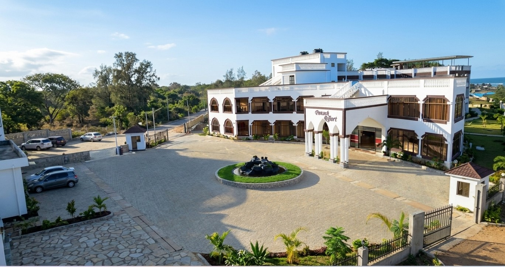
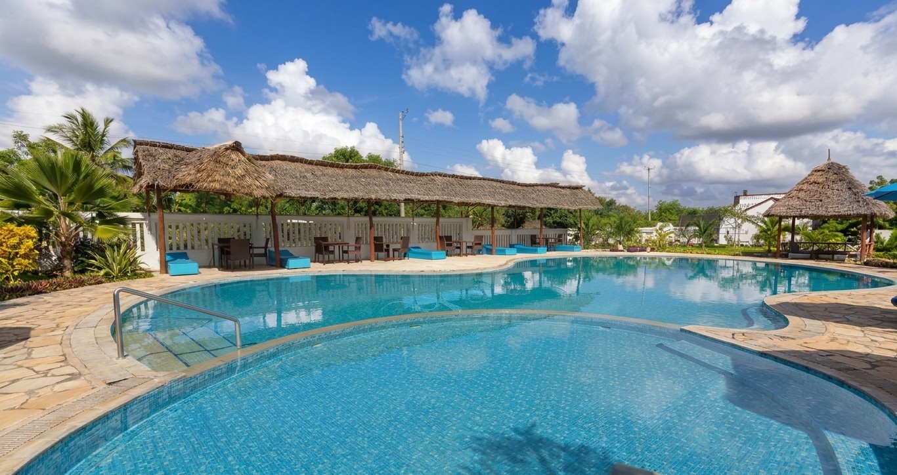
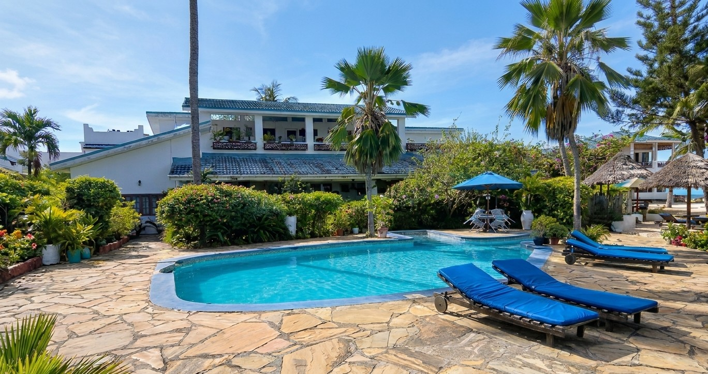

# Peacock Court Hotel

🔗 **[Click Here to View Live Website](https://github.io)**

---


---


A modern, responsive hotel landing page designed for Peacock Court Hotel in Kilifi, Kenya. The website presents the hotel’s identity, room offerings, amenities, and direct booking contact in a polished, user-friendly format.

## Preview

<div align="center">
  
</div>


### Hotel Showcase

<div align="center">
  <table>
    <tr>
      <td align="center">
        
      </td>
      <td align="center">
        
      </td>
    </tr>
  </table>
</div>


## Overview

Peacock Court Hotel is a warm, affordable accommodation option for guests visiting Kilifi. This landing page highlights the hotel’s convenient location, welcoming atmosphere, and comfortable rooms, with a clear call-to-action for reservations.

The design combines a premium coastal aesthetic with an elegant editorial style, using warm neutrals, rich green accents, and spacious layout sections to create a professional hospitality brand experience.

## Features

- Responsive single-page layout for desktop and mobile devices
- Hero section with strong hotel branding and booking CTA
- About section communicating the hotel’s value proposition
- Room showcase with pricing and enquiry call-to-action
- Amenities section highlighting core guest conveniences
- Contact section with direct phone booking link
- Clean typography with Tailwind CSS and Google Fonts

## Tech Stack

- HTML5
- Tailwind CSS via CDN
- Google Fonts
- Custom CSS for brand styling

## Project Structure

```text
.
├── index.html
├── assets/
│   ├── peacock-court-exterior.jpg
│   ├── peacock-court-interior.jpg
│   ├── peacock-court-pool.jpg
│   ├── peacock-court-pool-view.jpg
│   ├── peacock-court-guest-room.jpg
│   └── peacock-court-double-room.jpg
└── README.md
```

Note: If your project uses a different folder layout, simply place the images in the relevant asset directory and update the `src` attributes in `index.html`.

## Getting Started

1. Clone or download the project files.
2. Ensure all referenced images are available in your project folder.
3. Open `index.html` directly in a browser, or serve the project locally.

### Local preview with Python

```bash
cd your-project-folder
python -m http.server 8000
```

Then visit:

```text
http://localhost:8000
```

## Customization

You can easily adapt the page for your own hotel brand by updating:

- Hotel name and contact number
- Hero text and tagline
- Room categories and pricing
- Amenities and description text
- Brand colors and typography

## Booking Contact

Peacock Court Hotel
- Location: Charo Wamae Junction, Kilifi County
- Phone: +254 725 765 625

## License

This project is provided for educational and portfolio use. You may adapt and extend it for your own website or business branding as needed.

## Credits

This landing page was created to reflect a polished hospitality brand style using modern frontend practices and a warm coastal color palette.

